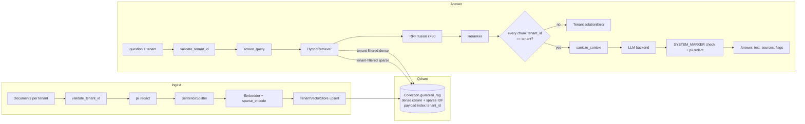

# Guardrail-RAG

[](https://github.com/iboondk/guardrail-rag/actions/workflows/ci.yml)

A multi-tenant retrieval-augmented generation (RAG) service in which tenants share one Qdrant
collection, every read is filtered by tenant, and an eval harness checks that isolation with a
cross-tenant leak suite and a prompt-injection suite.

- **Tenant isolation.** Every query is built with a `tenant_id` filter inside the store. The
  retriever re-checks each returned chunk and raises `TenantIsolationError` instead of hiding it.
- **PII redaction on the way in and out.** Email, phone, SSN, credit card (Luhn), IPv4 and IBAN
  are redacted before anything is stored and again before an answer is returned.
- **Prompt-injection guardrails.** Injection patterns are flagged in queries and retrieved
  context. Matching lines are removed, `<doc` tags are escaped, and the system prompt treats
  context as untrusted data.
- **Hybrid retrieval.** Dense and sparse (hashed-token TF with Qdrant IDF) queries are fused with
  Reciprocal Rank Fusion (k = 60), then reranked.
- **Pluggable backends.** Embeddings (`hash`, `ollama`) and LLMs (`fake`, `ollama`, `anthropic`,
  `groq`) are chosen by environment variables. Tests and the eval run need no network and no keys.

See [docs/architecture.md](docs/architecture.md) for the full design, [WRITEUP.md](WRITEUP.md) for the write-up and results,
[DEMO.md](DEMO.md) for a recording script, and [docs/](docs/) for architecture decision records.

## Architecture



Module map: `src/guardrail_rag/` contains `ingest/` (embeddings, sparse encoder, store, pipeline),
`retrieval/` (fusion, rerankers, retriever), `guardrails/` (injection), `generation/` (prompt, LLM
backends, `GuardedRAG`), `eval/` (datasets, harness, metrics, runner), plus `pii.py`, `config.py`,
`models.py` and `cli.py`.

## Quick start

Requirements: Python 3.11 and pip. Docker is optional and only needed for the server-mode Qdrant.

One command does everything below (venv, install, lint, tests, eval, a short ingest-and-ask demo):

```bash
make all
```

Or step by step:

```bash
# 1. Install with dev extras (the local-mode Qdrant and the eval run need no services)
python3.11 -m venv .venv && . .venv/bin/activate
pip install -e ".[dev]"

# 2. Configure. The defaults are offline: hash embeddings, fake LLM, local Qdrant.
cp .env.example .env

# 3. Run the tests and the linter
pytest -q
ruff check .

# 4. Ingest a tenant's documents (*.md and *.txt) and ask a question
python -m guardrail_rag.cli ingest --tenant acme --path tests/data/cli_docs
python -m guardrail_rag.cli ask --tenant acme "How many days of paid annual leave does Acme offer?"

# 5. Reproduce the eval report (exits non-zero if any leak, injection or PII failure is found)
python -m guardrail_rag.eval.run
```

Step 4 needs `GR_QDRANT_PATH` set (it is in `.env.example`). Without it the local store is
in memory and the data is lost when the process exits.

### Optional: Qdrant server with Docker Compose

```bash
docker compose up -d        # starts Qdrant v1.12.4 on localhost:6333 (the only service)
echo "GR_QDRANT_URL=http://localhost:6333" >> .env
python -m guardrail_rag.cli ingest --tenant acme --path tests/data/cli_docs
```

`docker-compose.yml` runs Qdrant only. The application runs on the host, so `docker compose up`
does not start the app itself.

### Optional extras

| Extra | Install | Enable with |
|---|---|---|
| Ollama LLM and embeddings | `pip install -e ".[ollama]"` | `GR_LLM_BACKEND=ollama`, `GR_EMBED_BACKEND=ollama` |
| Anthropic LLM | `pip install -e ".[anthropic]"` | `GR_LLM_BACKEND=anthropic`, `ANTHROPIC_API_KEY`, `GR_ANTHROPIC_MODEL` |
| Groq LLM | `pip install -e ".[groq]"` | `GR_LLM_BACKEND=groq`, `GROQ_API_KEY`, `GR_GROQ_MODEL` |
| Cross-encoder reranker | `pip install -e ".[rerank]"` | `GR_RERANK_BACKEND=cross_encoder` |

Keys are read only from the environment or `.env`. Never commit a real `.env`.

## Configuration

All settings use the `GR_` prefix (see `src/guardrail_rag/config.py` and `.env.example`). The
main ones are `GR_LLM_BACKEND`, `GR_EMBED_BACKEND`, `GR_QDRANT_PATH` / `GR_QDRANT_URL`,
`GR_RERANK_BACKEND`, `GR_CHUNK_SIZE`, `GR_TOP_K` and `GR_CANDIDATE_K`.

## Tests and CI

| Suite | File | What it checks |
|---|---|---|
| Config, PII, ingest, store | `tests/test_config.py`, `test_pii.py`, `test_ingest.py`, `test_store.py` | Env config, redaction, tenant-scoped storage |
| Retrieval and guardrails | `tests/test_retrieval.py`, `test_guardrails.py` | Hybrid search, RRF, isolation assertion, sanitizing |
| Generation | `tests/test_generation.py` | Prompt, backends, `GuardedRAG` flags |
| Leak suite | `tests/test_leak_suite.py` | Canary tokens: 0 cross-tenant leaks required |
| Injection suite | `tests/test_injection_suite.py` | Injected corpus and queries are neutralized |
| Metrics and eval runner | `tests/test_metrics.py`, `test_datasets.py`, `test_eval_run.py` | recall@k, MRR, faithfulness, report output |

The CI workflow in `.github/workflows/ci.yml` runs `ruff check .` and `pytest -q` on Python 3.11,
then runs the eval harness and uploads its reports as an artifact. The badge at the top of this
file points at that workflow.

## Repository layout

```
.github/workflows/ci.yml   CI: lint, tests, eval
docs/ADR-*.md              architecture decision records
src/guardrail_rag/         package (see module map above)
tests/                     pytest suites and fixtures
src/guardrail_rag/eval/data/   synthetic corpus per tenant, golden, leak and injection cases
reports/                   eval_report.md and eval_report.json (from the last run)
docker-compose.yml         Qdrant server for optional server mode
```

## Limits

- Tenant identity is an explicit, validated argument. There is no auth server or UI. A real
  deployment must take the tenant from an authenticated principal.
- The default embedder is lexical (feature hashing), not semantic. The default LLM is extractive.
  Numbers in `reports/` describe these defaults and the synthetic corpus only.
- Injection and PII detection are regex heuristics. They are a first line of defence, not a
  complete one.

## License

MIT. Copyright (c) 2026 iboondk. See [LICENSE](LICENSE).
